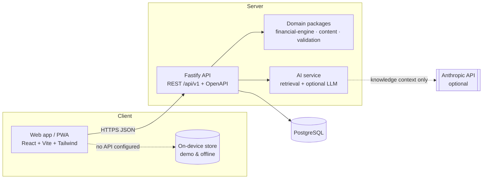

# Architecture

## System overview



The **same domain packages run on both sides**: the API uses them against PostgreSQL; the web app's on-device store uses them in the browser for the hosted demo and offline use. Numbers and rules therefore match everywhere.

## Monorepo

```
sakasuru/
├─ apps/
│  ├─ api/            Fastify + Drizzle ORM + PostgreSQL (also serves the web build)
│  │  ├─ src/modules/ auth · me · finance · learning · notifications · scam · ai · admin
│  │  ├─ src/db/      schema.ts · migrate.ts · seed.ts
│  │  ├─ drizzle/     SQL migrations
│  │  └─ test/        integration tests against real PostgreSQL
│  └─ web/            React 19 + Vite + Tailwind v4 + TanStack Query + motion + Recharts
│     ├─ src/data/    Api interface · remote.ts (HTTP) · local.ts (on-device)
│     ├─ src/features home · money · goals · learn · tools · scam · ai · profile · admin
│     └─ src/components ui · brand · layout
├─ packages/
│  ├─ financial-engine/  decimal.js calculations, health score, budgets, insights, scam rules, dashboard
│  ├─ content/           trilingual courses, quizzes, knowledge base, badges, challenges, learning rules
│  ├─ localization/      si / ta / en dictionaries (+ locales/*.json), rupee & DD/MM/YYYY formatters
│  └─ validation/        zod request schemas + response DTO types shared by API and web
├─ docs/  · Dockerfile · docker-compose.yml · render.yaml · .github/workflows/ci.yml
```

Layers: **API layer** (routes + zod validation) → **application services** (`*/service.ts`) → **domain** (pure packages, no I/O) → **data** (Drizzle/PostgreSQL). Admin, AI, notifications, content and audit are separate modules.

## Database (PostgreSQL)

Money columns are `NUMERIC(14,2)`; NUMERIC and DATE are read as strings and converted with decimal arithmetic. Free text and profile amounts are encrypted (`*_enc`).

```mermaid
erDiagram
  users ||--|| user_profiles : has
  users ||--|| user_preferences : has
  users ||--o{ consents : "consent log"
  users ||--o{ sessions : "refresh tokens"
  users ||--o{ transactions : records
  users ||--o{ recurring_transactions : schedules
  recurring_transactions ||--o{ transactions : generates
  users ||--o{ budgets : plans
  budgets ||--o{ budget_items : contains
  users ||--o{ financial_goals : sets
  financial_goals ||--o{ goal_contributions : receives
  users ||--o{ debts : owes
  debts ||--o{ debt_payments : repaid_by
  users ||--o{ financial_health_scores : monthly
  courses ||--o{ lessons : contains
  users ||--o{ quiz_attempts : takes
  users ||--o{ learning_progress : completes
  users ||--|| learning_streaks : xp
  users ||--o{ user_achievements : earns
  users ||--o{ challenge_participation : joins
  users ||--o{ notifications : receives
  users ||--o{ ai_conversations : "only with consent"
  ai_conversations ||--o{ ai_messages : contains
  users ||--o{ audit_logs : acts
```



Plus `ai_topic_stats` (anonymous counters, no user id) and `scam_alerts`. Lesson text for all three languages lives in `lessons.data` (JSONB) so the CMS edits content without code changes; `status`, `author_id`, `reviewer_id`, `last_reviewed`, `next_review` support verification.

## API (REST, `/api/v1`, OpenAPI at `/docs`)

| Area | Endpoints |
|---|---|
| Auth | `POST /auth/register` `/auth/login` `/auth/refresh` `/auth/logout` `/auth/change-password` · `GET /auth/me` `/auth/sessions` · `DELETE /auth/sessions/:id` |
| Me | `GET /me` · `PATCH /me/profile` `/me/preferences` `/me/consents` · `GET /me/export` · `DELETE /me` |
| Money | `GET /dashboard` `/health-score/history` · CRUD `/transactions` + `/transactions/import` · CRUD `/recurring` · `GET/PUT /budgets/:month` · CRUD `/goals` + `/goals/:id/contributions` · CRUD `/debts` + `/debts/:id/payments` · `GET /debts/simulate?extra=` · `GET /reports/monthly` |
| Learning | `GET /courses` `/lessons/:slug` `/badges` `/challenges` (public) · `GET /learning` · `POST /lessons/:slug/complete` `/challenges/:key/join` `/challenges/:key/complete` |
| Other | `GET /notifications` · `POST /notifications/:id/read` `/notifications/read-all` · `POST /scam/check` · `GET /scam/examples` `/scam/alerts` · `POST /ai/ask` · `GET/DELETE /ai/history` |
| Admin | `GET /admin/stats` `/admin/users` `/admin/lessons` `/admin/lessons/:slug` `/admin/audit-logs` `/admin/review-due` · `PATCH /admin/users/:id/role` · `PUT /admin/lessons/:slug` · `POST /admin/lessons/:slug/status` `/admin/scam-alerts` |

Errors are human-friendly JSON (`{ error, message }`); 500s never leak internals.

## Frontend

HashRouter (works on any static host), route-level code splitting, TanStack Query caching with targeted invalidation, skeleton loaders, error states with retry, empty states that invite action. All text comes from translation keys; layouts tolerate long Sinhala/Tamil strings.

## Mobile

The web app is built Android-first as an installable PWA: offline lessons/quizzes/calculators via a service worker, self-hosted fonts, data-saver mode, large touch targets. A React Native + Expo app can reuse `financial-engine`, `content`, `localization` and `validation` unchanged — it is planned, not built.

## Deployment

One container (`Dockerfile`) runs migrations and content seeding on start, then serves the API and the web build on the same origin (`WEB_DIST_DIR`). `render.yaml` provisions it with managed PostgreSQL. The web app can also be hosted alone: without `VITE_API_URL` it runs the on-device demo.
