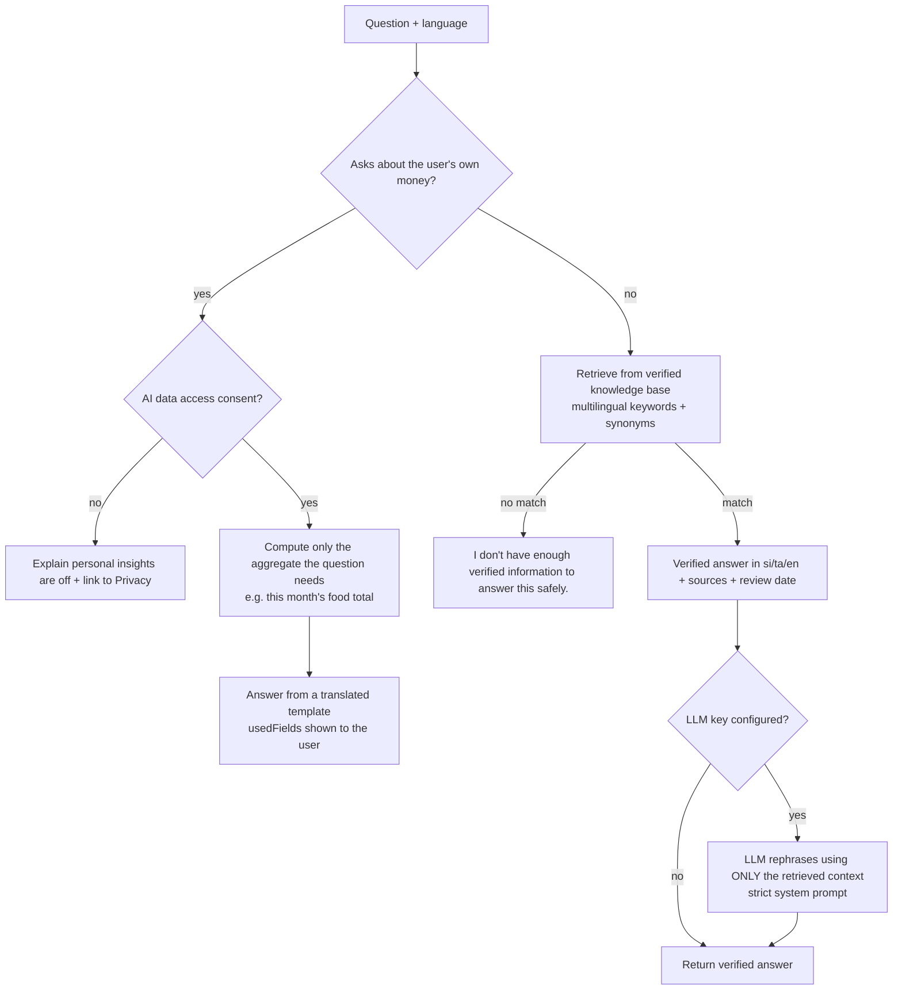

# සකසුරු AI — retrieval, safety and data protection

## Knowledge base

`packages/content/src/knowledge.ts` — 19 entries (fixed deposits, inflation, Treasury bills/bonds, LANKAQR, compound interest, saving before investing, housing loans, credit cards, emergency funds, budgeting, EPF/ETF, OTP safety, Ponzi schemes, unit trusts, shares & CSE, tax concepts, debt strategies, insurance, and a guardrail for recommendation requests). Each has trilingual answers, official sources (CBSL, SEC, CSE, IRD, EPF, ETF, IRCSL), a `lastReviewed` date and a `timeSensitive` flag. Time-sensitive entries do not quote rates; they point to the official source.

## Safety rules

- Never "buy this stock / take this loan / invest everything here". Recommendation requests route to an answer that explains factors to consider and suggests a licensed professional.
- Educational information is labelled as such on every answer.
- No retrieval match → the low-confidence message, never a guess.
- The optional LLM receives only the retrieved verified context and the conversation; it is told to answer only from that context, in the user's language, under 180 words. If the provider fails, the verified answer is returned.

## Personal data

- Off by default; requires explicit consent (`aiDataAccess`).
- **Personal insights are computed on the server from aggregates and are never sent to an external model.**
- Only the fields needed for the question are used, and they are listed back to the user (`usedFields`).
- Conversation history is stored (encrypted) only with `aiHistory` consent and is deleted when that consent is withdrawn.
- Admin analytics see anonymous topic counts only.

## Extending

Add entries to `KNOWLEDGE` (with sources and review dates) or move the knowledge base into the database and replace keyword retrieval with pgvector embeddings — the `searchKnowledge` interface stays the same.
